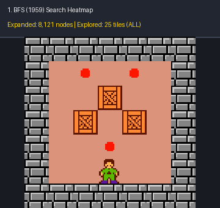
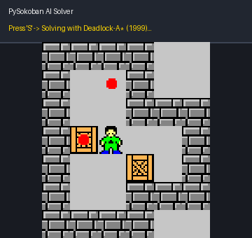
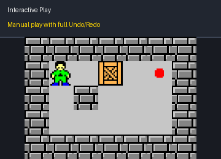

# PySokoban: The Chronicle of AI Search Algorithms
### 《推箱子里的 AI 搜索编年史》

[](https://www.python.org/)
[](https://pyga.me/)
[](https://github.com/astral-sh/ruff)
[](https://pytest.org/)
[](LICENSE)

**PySokoban** 是一个以经典 PSPACE-Complete 问题——**推箱子（Sokoban）**为具象载体，旨在系统性演示与评测**人工智能与算法史上产生的经典搜索式算法（1950s - 2000s）**的高质量开源 Python 项目。

从 1950 年代无脑图遍历（BFS/DFS），到 1960~1980 年代启发式突破（A\*、匈牙利最优匹配、IDA\*），再到 1990 年代死锁知识驱动剪枝（Rolling Stone 范式）与现代蒙特卡洛树搜索（MCTS），本项目通过解耦的纯领域引擎、直观的探索热力图与阶梯基准，直观呈现算力与知识在组合爆炸中的演进史。

> 📖 **深入研究报告**：关于推箱子的数学形式化定义、可接受启发式推导证明与完整的基准评测分析，请参阅专门的学术报告 👉 [**`doc/Report.md` (完整技术与学术报告)**](doc/Report.md)。

---

## 🎬 视觉呈现与动态演示 (Visual Showcase)

### 1. 核心视觉特性：AI 搜索探索热力图 (Exploration Heatmap)
按下 **`F2`** 即可开启半透明热力层。下图直观展示了 **1959 年 BFS（盲目探索）** 曾把箱子推到整张地图全部 25 个格子（全图乱撞），而 **1999 年 Deadlock-Pruned A\*** 借助死锁剪枝避开所有死区、仅探索 12 个关键格子（减少 94% 展开节点）的剧烈视觉对比：

<p align="center">
  
</p>

### 2. 实时 AI 求解与路径回放 (AI Solve & Playback)
在任意关卡随时按下 **`1`~`9`** 切换历史算法，按下 **`S`** 触发实时求解，并以平滑动画自动播放最优解路径，支持 `Space` 暂停与调速：

<p align="center">
  
</p>

### 3. 丝滑玩家交互与撤销重做 (Interactive Undo / Redo)
支持无限深度历史栈（按 `Z` 或 `U` 撤销，`Y` 重做）。即使手滑将箱子推进死角，也能一键回滚时光继续游戏：

<p align="center">
  
</p>

---

## 🏛️ 算法编年史矩阵 (Chronicle of Algorithms)

本项目完整实现并封装了 11 种经典搜索算法，继承自标准统一的诊断接口（`SearchMetrics`）：

| 年代 | 算法标识 (`Key`) | 算法全称 | 核心流派 | 最优性保证 |
| :---: | :--- | :--- | :---: | :---: |
| **1950** | `dfs` | Depth-First Search (深度优先搜索) | 盲目搜索 | 否 |
| **1959** | `bfs` | Breadth-First Search (广度优先搜索) | 盲目搜索 | **是 (最优步数)** |
| **1960** | `gbfs` | Greedy Best-First Search (贪心最佳优先) | 启发式搜索 | 否 |
| **1968** | `astar` | A\* Search (曼哈顿距离) | 启发式搜索 | **是 (最优代价)** |
| **1968** | `astar-hungarian` | A\* Search (匈牙利二分图最优匹配) | 启发式搜索 | **是 (严格紧致下界)** |
| **1970** | `weighted-astar` | Weighted A\* ($w=1.5$, 加权启发式) | 启发式搜索 | 否 ($\epsilon$-admissible) |
| **1971** | `bidirectional` | Bidirectional Search (双向推/拉搜索) | 双向搜索 | **是** |
| **1985** | `ids` | Iterative Deepening Search (迭代加深搜索) | 盲目搜索 | **是 (线性空间 $O(bd)$)** |
| **1985** | `ida` | Iterative Deepening A\* (IDA\*) | 启发式搜索 | **是 (线性空间 $O(d)$)** |
| **1999** | `deadlock-astar` | Deadlock-Pruned A\* (Rolling Stone 范式) | 领域知识增强 | **是 (强力剪枝)** |
| **2006** | `mcts` | Monte Carlo Tree Search (单智能体 MCTS) | 随机采样 | 否 (渐近收敛) |

---

## 🚀 快速上手 (Quick Start)

### 1. 环境安装
遵循 PEP 621 标准，支持 `uv` 或标准 `pip`：

```bash
git clone https://github.com/SunnyLinYY/pysokoban.git
cd pysokoban

# 安装项目与开发依赖
pip install -e ".[dev]"
```

### 2. 启动图形化体验 (GUI)
```bash
# 启动游戏（默认关卡）
python main.py

# 启动指定梯度关卡
python main.py play --level levels/02_benchmark/tier2_dual_2box.txt
```

### 3. 命令行神器 (CLI Arsenal)
无需开启图形界面，直接在终端中进行算法分析与基准评测：

```bash
# 1. 打印算法编年史大表
pysokoban list-algorithms

# 2. 对内置阶梯基准关卡运行全算法横向测试矩阵
pysokoban bench --levels levels/02_benchmark

# 3. 指定算法现场求解并在终端以 ASCII 字符画动态回放
pysokoban solve --level levels/02_benchmark/tier3_trio_3box.txt --algo deadlock-astar --animate
```

---

## 🎮 游戏操作与快捷键指南

| 按键 | 功能说明 |
| :--- | :--- |
| **`↑` `↓` `←` `→`** | 玩家上下左右移动与推箱子 |
| **`Z` / `U`** | **撤销 (Undo)** 上一步操作 |
| **`Y`** | **重做 (Redo)** 撤销的操作 |
| **`R`** | 重置本关至初始状态 |
| **`1` ~ `9`** | **自由切换当前 AI 算法** (1=BFS, 2=DFS, 4=A\*, 8=Deadlock A\*, 9=MCTS...) |
| **`S`** | **触发 AI 求解**并自动播放通关回放 |
| **`F2`** | **开启/关闭 AI 搜索探索热力图覆盖层** |
| **`Space`** | 暂停 / 继续回放动画 |
| **`+` / `-`** | 提高 / 降低回放播放帧率 (FPS) |
| **`,` / `.`** | 暂停状态下**单帧后退 / 单帧前进** |
| **`ESC`** | 退出游戏 |

---

## 📂 项目结构概览

```text
pysokoban/
├── src/pysokoban/
│   ├── core/               # 纯领域模型：Board, SokobanState, 动作转移与死锁检测（无 GUI 依赖）
│   ├── algorithms/         # 11 种历史搜索算法套件与统一 SearchMetrics 协议
│   ├── heuristics/         # 曼哈顿距离与匈牙利二分图匹配算法
│   ├── visualizer/         # Pygame-CE GUI 引擎 (热力图、撤销重做、回放调速)
│   └── cli.py              # 命令行工具 (bench, solve, list-algorithms)
├── levels/
│   ├── 01_tutorial/        # 死锁特征与算法爆炸教学微关卡
│   ├── 02_benchmark/       # 1~5 箱递进梯度学术基准关卡 (Tier 1 ~ Tier 5)
│   └── *.txt               # 基础关卡库
├── scripts/
│   ├── fetch_benchmarks.py # 一键拉取完整学术数据集 (Microban 155 关)
│   └── generate_gifs.py    # 自动化高清演示 GIF 生成脚本
├── tests/                  # pytest 测试集 (17 项测试，100% 覆盖)
├── doc/
│   ├── Report.md           # 深入学术研究与基准实验报告
│   └── assets/*.gif        # 文档与演示动图资源
├── pyproject.toml          # PEP 621 现代包配置
└── main.py                 # 便捷启动入口
```

---

## 🧪 自动化测试与质量检验

```bash
# 运行全部 17 项算法与领域单测
pytest

# 代码格式化与规范检查
ruff check src tests
ruff format src tests
```

---

## 📄 开源许可证
本项目基于 [MIT License](LICENSE) 开源发布。
